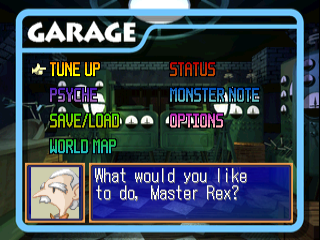
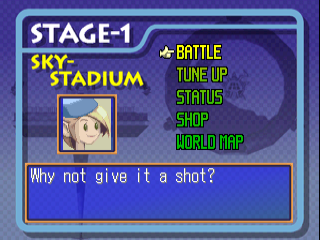

# Gangway Monsters English Patch

This is the English patch for the PS1 game, [Gangway Monsters](https://www.giantbomb.com/gangway-monsters/3030-23375/).

The translation was first made with Google Translate, and has since been reworked by hand: the field events, menus, casino, monster book, opening and ending, and the images with text in them.

## How to apply patch

* Obtain a ROM of the game: the Japanese release, as one `.bin` file and one `.cue` file. The patch is for the `.bin` with these checksums:
  * CRC32: `4ab65ea6`
  * MD5: `124e592618437b3475f4c81d8c045a75`
  * SHA-1: `b671ccc3306ddcf58c09c4f8ee175dd1e26e27b0`
* Download `Gangway Monsters (English) <version>.xdelta` from the [releases page](../../releases).
* Open [Rom Patcher JS](https://www.marcrobledo.com/RomPatcher.js/) in your browser, choose the game's `.bin` as the ROM file and the `.xdelta` as the patch, and press "Apply patch". It shows the ROM's checksums when you choose it, so you can compare them with the ones above. (On Windows, [Delta Patcher](https://github.com/marco-calautti/DeltaPatcher) works too; on the command line, `xdelta3 -d -s game.bin "Gangway Monsters (English) <version>.xdelta" english.bin`.)
* Keep the `.cue` file next to the patched `.bin`, with the `FILE` line inside it changed to the patched `.bin`'s name.

## Screenshots

  

## Building a Patch

* See `scripts` for scripts used to create the patch. Keep in mind some of them are just one-off scripts used to save some time. The main script is `replace_bytes.py`, which also updates game logic to work with English words.
* `en-ja` contains the Japanese/English pairings for translation.
* `graphics` contains the translated images, as PNGs (see [NOTES.md](NOTES.md#graphics)).
* To build: install Pillow (`pip3 install -r scripts/requirements.txt`), put the original Japanese `.bin` at `rom/Gangway Monsters (Japan).bin`, and run `scripts/build.sh`. It writes `rom/Gangway Monsters (English).bin`. To use a `.bin` somewhere else, run `scripts/build.sh /path/to/japanese.bin [/path/to/english.bin]`. Add `--no-info-screen` to leave out the screen with the translation's credits and version after the Sony Music logo.
* To make the patch for a release: `scripts/make_patch.sh` (needs `xdelta3`). It builds, then writes `rom/Gangway Monsters (English) <version>.xdelta` (the version at the top of `CHANGELOG.md`) and checks that it reproduces the English `.bin`. With `--no-info-screen` it builds without the credits screen and adds `(no info screen)` to the patch's name.

## Reporting bugs, typos, etc.

Create an [issue](https://github.com/stephwag/gangway-monsters-english-patch/issues). See [known issues](https://github.com/stephwag/gangway-monsters-english-patch/issues/1) for currently known issues.

## Contributing

If you happen to know Japanese and want to help correct any translations, please contribute! The least accurate translations are probably the "monbook" ones, and any dialogue with a lot of "emotion" in it.

If you want to contribute by fixing bugs or adding features, see [NOTES.md](NOTES.md) for notes on what parts were changed (it will probably save you some time) and any TODOs related to those changes.
